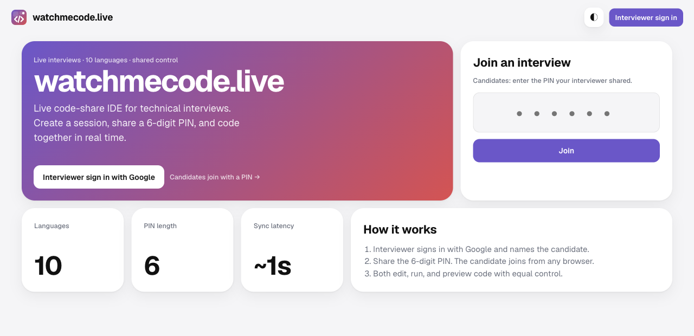
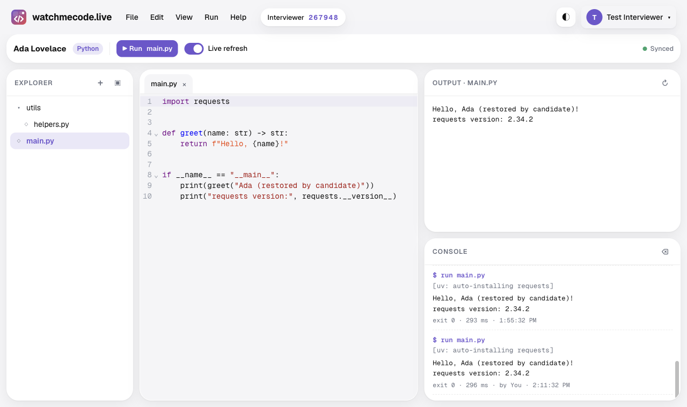
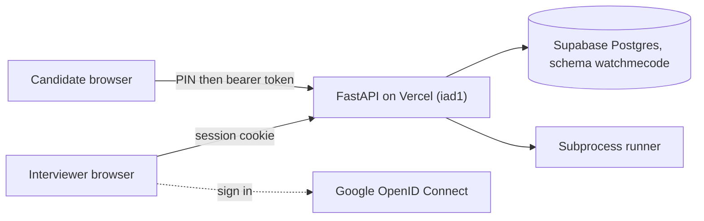

# watchmecode.live

**Share a 6-digit PIN, open one editor, and run real code together. A live interview IDE that boots in one click.**

```text
Interviewer → Generate PIN for "Ada Lovelace"  →  482913
Candidate   → https://watchmecode.live → 482913 → Join
Both        → edit main.py · ▶ Run · see each other's changes in ~1s
```



**Live:** [watchmecode.live](https://watchmecode.live) · **API:** [watchmecode.live/docs](https://watchmecode.live/docs) · **Docs:** [`docs/`](docs/index.md), published to Read the Docs at `watchmecode-live.readthedocs.io` once the project is imported (see [Deployment](docs/deployment.md#read-the-docs))

## What you get

| Feature | Details |
| --- | --- |
| PIN sessions | Interviewers name a candidate and get a unique 6-digit PIN. Ending a session retires the PIN. |
| Equal control | Explorer, tabs, editor, console, preview, and Run are shared. Edits sync in about a second. |
| 10 languages + web | Python, JavaScript, TypeScript, Java, C#, C++, C, Go, PHP, Shell, and an HTML/CSS/JS playground. |
| Zero-setup imports | `import requests` or `require('lodash')` just works. Python and Node packages install on Run. |
| Live refresh | Toggle it on and code re-runs a moment after you stop typing. |
| Candidate portal | Sessions grouped by candidate. Reopen any of them after the interview to review files and runs. |
| Record and replay | Interviewers press ● Record; both sides see a REC badge. Replay edits, file changes, and runs later at 1x, 2x, or 4x with a seek bar. |
| Google sign-in | OpenID Connect with PKCE. Name and avatar sit top right with a Log out dropdown. |
| Light and dark | Bento Box design, custom favicon, works on phones. |



## How to log in

**Interviewers** click **Interviewer sign in with Google** on [watchmecode.live](https://watchmecode.live). Any Google account works. You land on the candidate portal: type the candidate's name, pick a starter language, and press **Generate PIN**.

**Candidates** need no account. Open [watchmecode.live](https://watchmecode.live), type the PIN from your interviewer into **Join an interview**, and press **Join**. The PIN stops working once the interviewer ends the session.

## Quick start

```bash
git clone https://github.com/levensailor/watchmecode.live.git
cd watchmecode.live
cp .env.example .env   # fill in the Google values and SESSION_SECRET
uv sync
uv run uvicorn api.index:app --reload
```

Open http://127.0.0.1:8000. Run the tests with `uv run pytest`.

Local runs use SQLite (`watchmecode.db`). Set `DATABASE_URL` or `POSTGRES_URL` to use Postgres instead.

### Settings

All settings come from `.env` locally and from Vercel environment variables in production.

| Variable | Purpose |
| --- | --- |
| `GOOGLE_CLIENT_ID`, `GOOGLE_CLIENT_SECRET` | Google OAuth client for interviewer sign-in |
| `GOOGLE_REDIRECT_URI` | Must exactly match an authorized redirect URI on the Google client |
| `GOOGLE_SCOPES` | Defaults to `openid email profile` |
| `SESSION_SECRET` | Signs the session cookie and candidate tokens. Generate with `python -c "import secrets; print(secrets.token_urlsafe(48))"` |
| `POSTGRES_URL` / `DATABASE_URL` | Postgres connection. Empty means SQLite |
| `DB_SCHEMA` | Postgres schema for the tables (default `watchmecode`) |
| `RUN_TIMEOUT_SECONDS`, `INSTALL_TIMEOUT_SECONDS` | Runner limits (defaults 20 and 120) |
| `VERCEL_TOKEN`, `VERCEL_ORG_ID`, `VERCEL_PROJECT_ID` | Only for non-interactive CLI deploys |

Google's authorized redirect URIs must include both:

- `http://127.0.0.1:8000/auth/google/callback` (local)
- `https://watchmecode.live/auth/google/callback` (production)

## Deploy

Pushing to `main` deploys to production on Vercel. Every other branch gets its own preview URL. GitHub Actions runs `uv run pytest` on every push and pull request.

One-time setup, already done for this project:

```bash
vercel link --yes --project watchmecode-live
vercel domains add watchmecode.live
printf '%s' "$SESSION_SECRET" | vercel env add SESSION_SECRET production
vercel env add SESSION_SECRET preview "" --value "$SESSION_SECRET" --yes
```

Repeat `vercel env add` for each Google variable. The function runs in `iad1` with the FastAPI preset. `pyproject.toml` points Vercel at `api.index:app`.

**Database.** Production uses the Supabase Postgres resource `supabase-orange-park` from the Vercel Marketplace, connected to this project so `POSTGRES_URL` is injected. All tables live in the `watchmecode` schema with row-level security on, so they never collide with the other apps sharing that database. The schema is created on startup from [`sql/schema_postgres.sql`](sql/schema_postgres.sql). The SQLite version is [`sql/schema.sql`](sql/schema.sql).

### Runtimes on Vercel

The Vercel Python runtime has Python and bash, and nothing else. Every other language returns a clear "not installed on this server" message there. Run the app on a machine with the toolchains to use all ten.

| Language | Vercel | Self-hosted (toolchain on PATH) |
| --- | --- | --- |
| Python | Runs. Imports auto-install with pip | Runs. Imports auto-install with `uv run --with` |
| Shell | Runs | Runs |
| JavaScript | Not available | Node, `npm install` for imports, `nvm use` when nvm exists |
| TypeScript | Not available | Node + `tsx` (installed on first run) |
| Java, C, C++, Go, PHP, C# | Not available | `javac`/`java`, `gcc`, `g++`, `go mod tidy && go run .`, `php`, `dotnet run` or Mono |
| HTML/CSS/JS | Renders in the browser preview | Renders in the browser preview |

## Architecture



Both browsers poll `GET /api/sessions/{id}/changes?since=` every second. Vercel functions cannot hold WebSockets. More diagrams live in [docs/architecture.md](docs/architecture.md).

## Project layout

| Path | Contents |
| --- | --- |
| `api/index.py` | Vercel entrypoint exporting `app` |
| `app/` | Config, logging, auth, repository, schemas, routes, runner, language templates |
| `static/` | Single-page UI, CSS, favicon, vendored CodeMirror bundle |
| `frontend/` | Builds `static/vendor/codemirror.js` (`cd frontend && npm install && npm run build`) |
| `sql/` | SQLite and Postgres schemas |
| `tests/` | pytest suite |
| `docs/` | MkDocs site for Read the Docs |

Logs go to stdout and to `logs/app.log`, which rotates at 1 MB and keeps 3 backups. Timestamps are in America/New_York, with `file:line` and the function name. On Vercel the file lives in `/tmp/logs`.

## Author

<a href="https://github.com/levensailor"></a>

**levensailor**<br/>
[](https://github.com/levensailor)

<br clear="left"/>

See [CONTRIBUTING.md](CONTRIBUTING.md) to propose changes and [CHANGELOG.md](CHANGELOG.md) for release history.
