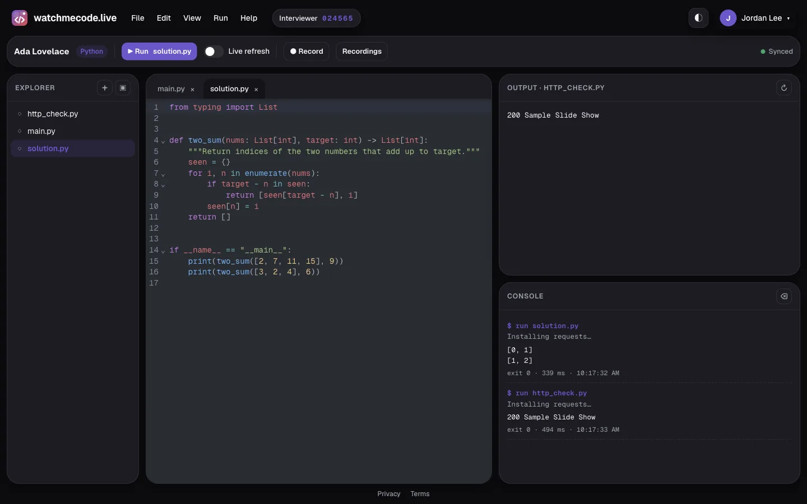
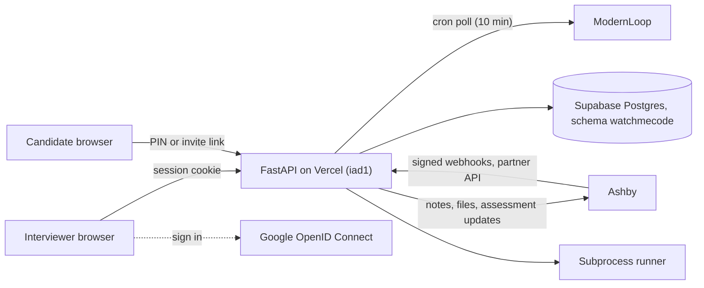

# watchmecode.live

**Coding interviews that feel like pairing. Share a PIN, code together in a real IDE, replay every keystroke, and give every customer their own subdomain.**

```text
Company     → watchmecode.live/signup → "American Eagle" → ae.watchmecode.live (14-day trial)
Interviewer → ae.watchmecode.live → Generate PIN for "Ada Lovelace" → 482913
Candidate   → ae.watchmecode.live → 482913 → Join · edit main.py · ▶ Run · changes sync in ~1s
```



**Live:** [watchmecode.live](https://watchmecode.live) · **API:** [watchmecode.live/docs](https://watchmecode.live/docs) · **Docs:** [`docs/`](docs/index.md), published to Read the Docs at `watchmecode-live.readthedocs.io` once the project is imported (see [Deployment](docs/deployment.md#read-the-docs))

## What you get

| Feature | Details |
| --- | --- |
| PIN sessions | Interviewers name a candidate and get a unique 6-digit PIN. Ending a session retires the PIN. |
| Equal control | Explorer, tabs, editor, console, preview, and Run are shared. Edits sync in about a second. |
| 10 languages + web | Python, JavaScript, TypeScript, Java, C#, C++, C, Go, PHP, Shell, and an HTML/CSS/JS playground. |
| Zero-setup imports | `import requests` or `require('lodash')` just works. Python and Node packages install on Run. |
| Live refresh | Toggle it on and code re-runs a moment after you stop typing. |
| Candidate portal | Sessions grouped by candidate. Reopen any of them after the interview to review files and runs. |
| Record and replay | Interviewers press ● Record; both sides see a REC badge. Replay edits, file changes, and runs later at 1x, 2x, or 4x with a seek bar. |
| Organizations | Teams share sessions, manage members, and issue API keys from **Organization settings**. |
| Ashby | Scheduled interviews become sessions automatically. The join link goes into invites, and results, code, and playback come back to the candidate profile. |
| ModernLoop | Polls ModernLoop every 10 minutes and creates sessions for newly scheduled interviews. |
| Take-homes | Timed, solo assessments with a Submit button, started from Ashby's interview plan. |
| Public API | `POST /v1/pads` returns a candidate join link, so any scheduler or ATS can create interviews. |
| Labs | SQL (CSV files become tables), React with live preview and no build step, and a shared Excalidraw whiteboard. |
| Prompt lab (AI) | Candidates write the prompt they'd give a coding agent. An AI reviewer on Vercel AI Gateway plays that agent and scores intent, guardrails, and context (MCP servers, integrations, files). |
| Sandbox runner | `SANDBOX_BACKEND=sandbox` runs all ten languages in a per-session Vercel Sandbox microVM. |
| Workspaces | Each customer gets `<slug>.watchmecode.live` with its own Postgres schema, members, and sign-in domains. Enterprise gets a dedicated instance. |
| Plans and billing | 14-day trial, Starter, Team, and Enterprise; Stripe Checkout, Customer Portal, and metered interview credits. |
| Product site | Home, features, labs, integrations, pricing, customers, security, signup, and a workspace picker on the apex. |
| Google sign-in | OpenID Connect with PKCE at one hub; workspaces get signed Ed25519 handoffs. Name and avatar sit top right with a Log out dropdown. |
| Light and dark | Bento Box design, custom favicon, works on phones. |


## How to log in

**Today (single workspace):** interviewers click **Interviewer sign in with Google** on [watchmecode.live](https://watchmecode.live). Any Google account works. You land on the candidate portal: type the candidate's name, pick a starter language, and press **Generate PIN**.

**With workspaces on** (`ROOT_DOMAIN=watchmecode.live`):

| Who | Where | How |
| --- | --- | --- |
| New customer | [watchmecode.live/signup](https://watchmecode.live/signup) | Continue with Google, name the workspace, pick a subdomain. You're the owner, on a 14-day trial. |
| Interviewer | `https://<slug>.watchmecode.live` or [watchmecode.live/login](https://watchmecode.live/login) | Sign in with Google once at the hub; it hands you to every workspace you belong to. Admins add members or whole Google domains under **Workspace & billing**. |
| Existing users | [app.watchmecode.live](https://app.watchmecode.live) | Everything created before workspaces lives in the `app` workspace, open to any Google account. Old `watchmecode.live/#/s/…` and `/j/…` links redirect there. |

**Candidates** need no account. Open the invite link (`/j/…`) from the interview email, or open the workspace URL and type the PIN into **Join an interview**. The PIN stops working once the interviewer ends the session.

## Integrations

```bash
curl -s https://watchmecode.live/v1/pads \
  -H "Authorization: Bearer $WATCHMECODE_API_KEY" \
  -H "Content-Type: application/json" \
  -d '{"candidate_name":"Ada Lovelace","title":"Backend onsite","language":"python"}'
# → {"id": "…", "join_url": "https://watchmecode.live/j/…", "interviewer_url": "…", "pin": "482913", …}
```

| Integration | What it does | Guide |
| --- | --- | --- |
| Ashby (live interviews) | Signed webhooks create one session per interview event, write the join link to a candidate custom field and a note, and post results, the final code, and playback when the session ends | [docs/integrations/ashby.md](docs/integrations/ashby.md) |
| Ashby (take-homes) | Assessments Partner API at `/partners/ashby` starts timed take-homes and reports status and results | [docs/integrations/ashby.md](docs/integrations/ashby.md#take-home-assessments-assessments-partner-api) |
| ModernLoop | A Vercel cron polls the Platform API and creates sessions for scheduled interviews. Native coding-link support is pitched in the guide. | [docs/integrations/modernloop.md](docs/integrations/modernloop.md) |
| Public API | Create, read, and end pads, and fetch results and a code zip, with an org API key | [docs/api.md](docs/api.md) |

Set it up under **Organization settings** (account menu → Organization settings). Research notes behind the design are in [docs/integrations/research.md](docs/integrations/research.md).

## Quick start

```bash
git clone https://github.com/levensailor/watchmecode.live.git
cd watchmecode.live
cp .env.example .env   # fill in the Google values and SESSION_SECRET
uv sync
uv run uvicorn api.index:app --reload
```

Open http://127.0.0.1:8000. Run the tests with `uv run pytest`.

Local runs use SQLite (`watchmecode.db`). Set `DATABASE_URL` or `POSTGRES_URL` to use Postgres instead.

### Settings

All settings come from `.env` locally and from Vercel environment variables in production.

| Variable | Purpose |
| --- | --- |
| `GOOGLE_CLIENT_ID`, `GOOGLE_CLIENT_SECRET` | Google OAuth client for interviewer sign-in |
| `GOOGLE_REDIRECT_URI` | Must exactly match an authorized redirect URI on the Google client |
| `GOOGLE_SCOPES` | Defaults to `openid email profile` |
| `SESSION_SECRET` | Signs the session cookie and candidate tokens. Generate with `python -c "import secrets; print(secrets.token_urlsafe(48))"` |
| `POSTGRES_URL` / `DATABASE_URL` | Postgres connection. Empty means SQLite |
| `DB_SCHEMA` | Postgres schema for the tables (default `watchmecode`) |
| `RUN_TIMEOUT_SECONDS`, `INSTALL_TIMEOUT_SECONDS` | Runner limits (defaults 20 and 120) |
| `INTEGRATION_ENCRYPTION_KEY` | Fernet key that encrypts stored Ashby and ModernLoop credentials |
| `CRON_SECRET` | Bearer token Vercel cron sends to `/api/cron/modernloop` |
| `ASHBY_PARTNER_ID` | `partnerId` for `assessment.addCompletedToCandidate` (default `watchmecode`) |
| `RESEND_API_KEY`, `EMAIL_FROM` | Optional: email take-home invites to candidates |
| `JOIN_LINK_MAX_AGE` | Seconds candidate invite links stay valid (default 30 days) |
| `ROOT_DOMAIN` | Turns on workspaces: the apex serves the product site, `<slug>.ROOT_DOMAIN` serves each workspace. Empty keeps one workspace |
| `PLATFORM_SCHEMA`, `TRIAL_DAYS` | Postgres schema for tenants, memberships, and usage (default `platform`); trial length (default 14) |
| `HANDOFF_PRIVATE_KEY` | Ed25519 key the sign-in hub signs workspace handoffs with (derived from `SESSION_SECRET` if empty) |
| `TENANT_MODE=dedicated`, `TENANT_SLUG`, `AUTH_HUB_URL`, `HANDOFF_PUBLIC_KEY` | Dedicated Enterprise instances (set by `scripts/provision_dedicated.py`) |
| `STRIPE_SECRET_KEY`, `STRIPE_WEBHOOK_SECRET`, `STRIPE_PRICES` | Billing; `scripts/stripe_setup.py --apply` creates prices, the meter, and the webhook |
| `SANDBOX_BACKEND`, `SANDBOX_SESSION_MINUTES` | `sandbox` runs code in Vercel Sandbox microVMs (default `local`) |
| `AI_GATEWAY_MODEL`, `AI_GATEWAY_FALLBACK_MODEL` | Prompt lab reviewer models (defaults `anthropic/claude-sonnet-5.5`, then `google/gemini-2.5-flash` when the first isn't available to the team). Auth uses the Vercel OIDC token, or `AI_GATEWAY_API_KEY` if set |
| `VERCEL_TOKEN`, `VERCEL_ORG_ID`, `VERCEL_PROJECT_ID` | Only for non-interactive CLI deploys |

Google's authorized redirect URIs must include both:

- `http://127.0.0.1:8000/auth/google/callback` (local)
- `https://watchmecode.live/auth/google/callback` (production)

## Deploy

Pushing to `main` deploys to production on Vercel. Every other branch gets its own preview URL. GitHub Actions runs `uv run pytest` on every push and pull request.

One-time setup, already done for this project:

```bash
vercel link --yes --project watchmecode-live
vercel domains add watchmecode.live
printf '%s' "$SESSION_SECRET" | vercel env add SESSION_SECRET production
vercel env add SESSION_SECRET preview "" --value "$SESSION_SECRET" --yes
```

Repeat `vercel env add` for each Google variable. The function runs in `iad1` with the FastAPI preset. `pyproject.toml` points Vercel at `api.index:app`.

**Database.** Production uses the Supabase Postgres resource `supabase-orange-park` from the Vercel Marketplace, connected to this project so `POSTGRES_URL` is injected. All tables live in the `watchmecode` schema with row-level security on, so they never collide with the other apps sharing that database. The schema is created on startup from [`sql/schema_postgres.sql`](sql/schema_postgres.sql). The SQLite version is [`sql/schema.sql`](sql/schema.sql).

### Turning on workspaces

Production runs as one workspace until `ROOT_DOMAIN` is set. To switch:

1. `vercel domains add '*.watchmecode.live'` (the domain is on Vercel DNS, so the wildcard certificate is automatic).
2. Set `ROOT_DOMAIN=watchmecode.live`, `PUBLIC_URL=https://watchmecode.live`, and `HANDOFF_PRIVATE_KEY` in Vercel, then push.
3. Keep `https://watchmecode.live/auth/google/callback` as the Google redirect URI. Sign-in always happens at the apex.
4. Optional: `uv run python scripts/stripe_setup.py --apply` and add the three `STRIPE_*` variables.

The existing `watchmecode` schema becomes the `app` workspace automatically, and new workspaces get `t_<slug>` schemas on signup. See [docs/deployment.md](docs/deployment.md#workspaces).

### Runtimes on Vercel

The Vercel Python runtime has Python and bash, and nothing else. With `SANDBOX_BACKEND=sandbox`, every language runs in a Vercel Sandbox microVM instead. Toolchains install on first use per session, and authentication uses the deployment's OIDC token.

| Language | Vercel (local runner) | Vercel with `SANDBOX_BACKEND=sandbox` |
| --- | --- | --- |
| Python | Runs; imports auto-install with pip | Runs; imports auto-install with pip |
| Shell | Runs | Runs |
| JavaScript, TypeScript | Not available | Node 24, `npm install` for imports, `tsx` |
| Java, C, C++, Go, PHP, C# | Not available | Installed on first run: JDK, gcc, g++, Go, PHP, .NET 10 |
| SQL lab | Runs (SQLite) | Runs (SQLite) |
| HTML/CSS/JS, React lab, whiteboard | In the browser | In the browser |

## Architecture



Both browsers poll `GET /api/sessions/{id}/changes?since=` every second. Vercel functions cannot hold WebSockets. More diagrams live in [docs/architecture.md](docs/architecture.md).

## Project layout

| Path | Contents |
| --- | --- |
| `api/index.py` | Vercel entrypoint exporting `app` |
| `app/` | Config, logging, auth, repository, schemas, routes, runner, language templates, orgs, public API, results |
| `app/integrations/` | Ashby (webhooks, partner API, write-back), ModernLoop poller, email, HTTP clients |
| `app/tenancy.py`, `app/platform.py` | Host-based workspace routing, schema-per-workspace repositories, and the platform store |
| `app/handoff.py`, `app/platform_api.py` | Sign-in hub handoff tokens; signup, workspace settings, and the Stripe webhook |
| `app/plans.py`, `app/billing.py` | Plan entitlements, credit metering, and Stripe |
| `app/site.py`, `templates/site/` | Product site (Jinja2) |
| `app/labs/`, `app/sandbox_runner.py` | SQL lab runner and the Vercel Sandbox runner |
| `scripts/` | `migrate.py`, `stripe_setup.py`, `provision_dedicated.py`, `seed_demo.py` |
| `static/` | Single-page UI, product site CSS/JS, whiteboard, screenshots, favicon, vendored CodeMirror bundle |
| `frontend/` | Builds `static/vendor/codemirror.js` (`cd frontend && npm install && npm run build`) |
| `sql/` | SQLite and Postgres schemas |
| `tests/` | pytest suite |
| `docs/` | MkDocs site for Read the Docs |

Logs go to stdout and to `logs/app.log`, which rotates at 1 MB and keeps 3 backups. Timestamps are in America/New_York, with `file:line` and the function name. On Vercel the file lives in `/tmp/logs`.

## Author

<a href="https://github.com/levensailor"></a>

**levensailor**<br/>
[](https://github.com/levensailor)

<br clear="left"/>

See [CONTRIBUTING.md](CONTRIBUTING.md) to propose changes and [CHANGELOG.md](CHANGELOG.md) for release history.
