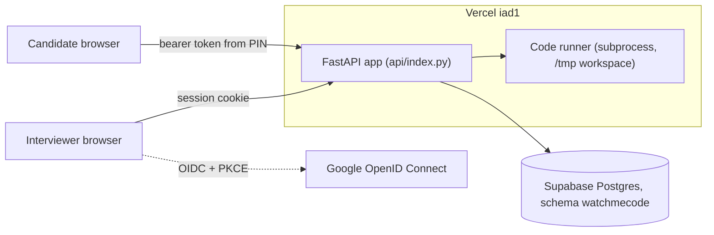
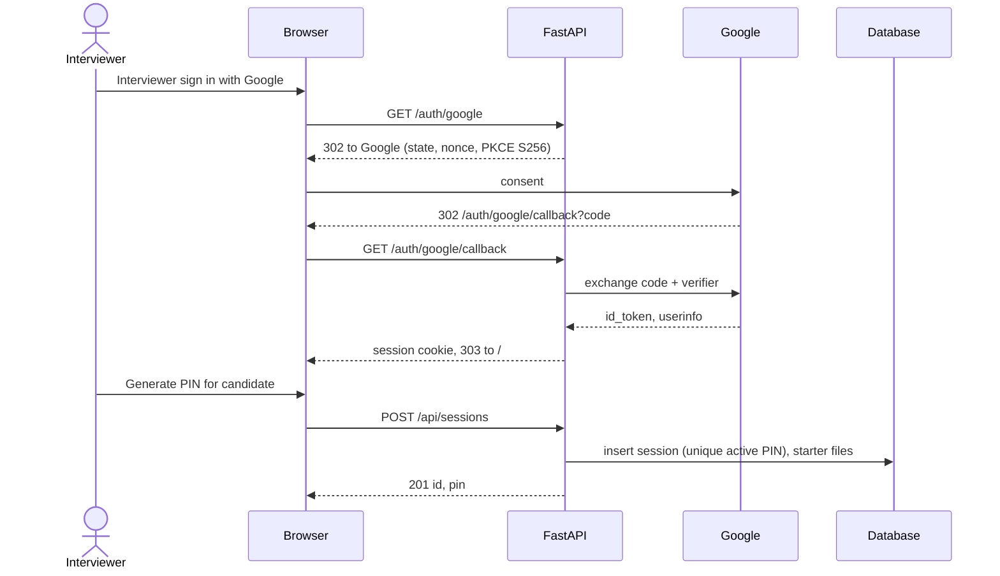
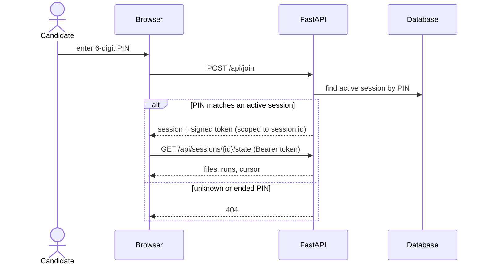
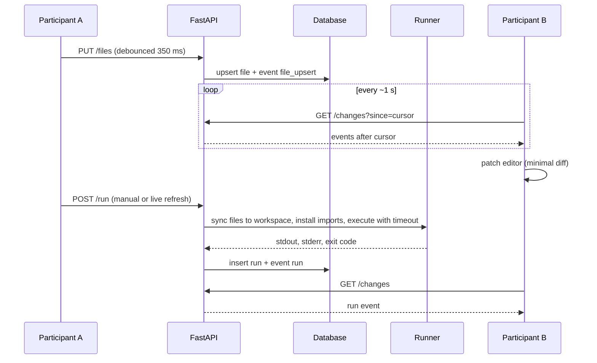

# Architecture

## System

| Piece | File |
| --- | --- |
| Settings | `app/config.py` |
| Logging (stdout + rotating file, EST) | `app/logging_config.py` |
| Google sign-in, candidate tokens | `app/auth.py` |
| Storage (SQLite or Postgres) | `app/repository.py`, `sql/` |
| HTTP routes | `app/routes.py` |
| Runner and language support | `app/runner.py`, `app/languages.py` |
| UI | `static/index.html`, `static/app.js`, `static/app.css` |

## Interviewer flow

## Candidate join flow

## Run and sync

Vercel functions cannot hold WebSockets, so both browsers poll an append-only change feed. Each request carries an `X-Client-Id`, and a browser skips its own events.

## Storage

Tables: `sessions`, `files`, `runs`, and `events`, the change feed. A partial unique index keeps PINs unique among active sessions. On Postgres, every connection runs `SET LOCAL search_path` to the `watchmecode` schema. That setting lasts only for the transaction, which is safe behind Supabase's transaction-mode pooler.
