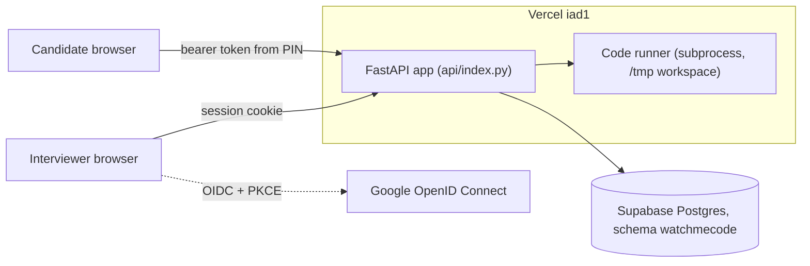
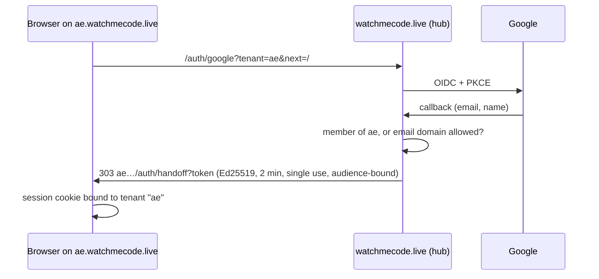
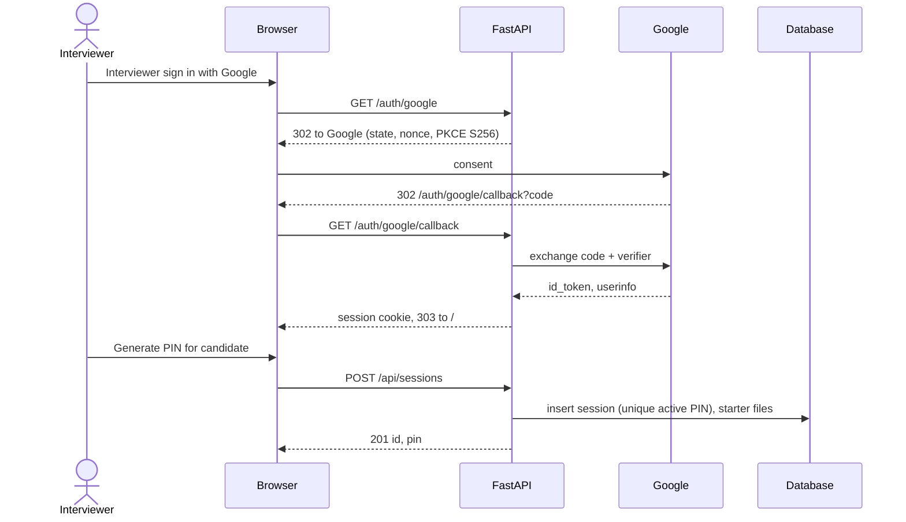
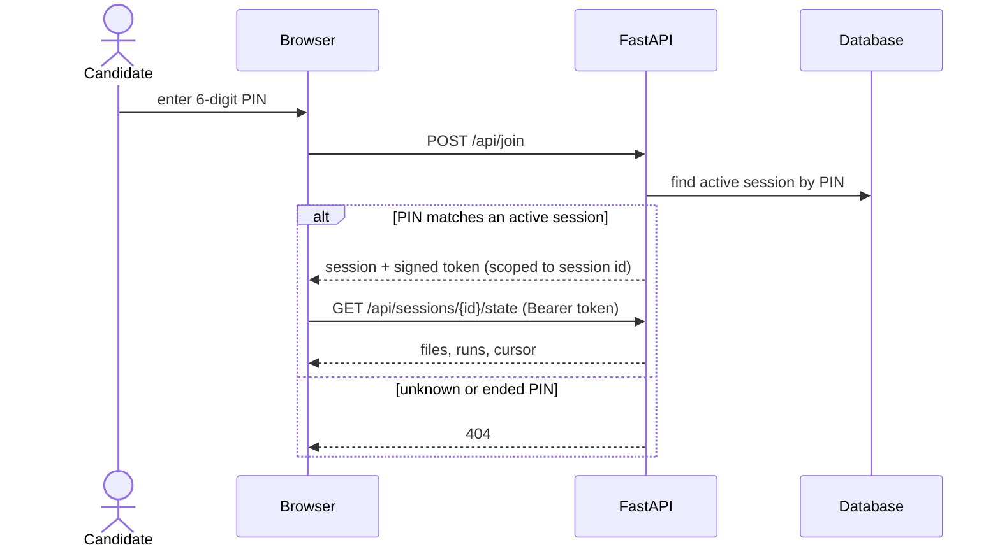
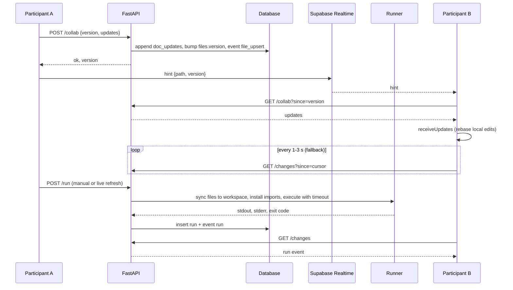

# Architecture

## System

| Piece | File |
| --- | --- |
| Settings | `app/config.py` |
| Logging (stdout + rotating file, EST) | `app/logging_config.py` |
| Google sign-in, candidate tokens | `app/auth.py` |
| Storage (SQLite or Postgres) | `app/repository.py`, `sql/` |
| HTTP routes | `app/routes.py` |
| Runner and language support | `app/runner.py`, `app/languages.py` |
| UI | `static/index.html`, `static/app.js`, `static/app.css` |
| Workspace routing and per-workspace repositories | `app/tenancy.py`, `app/platform.py`, `sql/platform*.sql` |
| Sign-in hub handoff (Ed25519) | `app/handoff.py`, `app/auth.py` |
| Plans, metering, Stripe | `app/plans.py`, `app/billing.py`, `app/platform_api.py` |
| Product site | `app/site.py`, `templates/site/`, `static/site.css`, `static/site.js` |
| Labs and sandbox runner | `app/labs/sql_lab.py`, `app/sandbox_runner.py`, `static/whiteboard.html` |

## Workspaces

Every request passes through `TenantMiddleware`, which maps the `Host` header to a tenant and sets two context variables: the tenant, and its `Repository`. `app.state.repo` is a proxy that resolves to the current request's repository, so routes, integrations, and background tasks need no tenant plumbing. Shared workspaces store data in Postgres schema `t_<slug>` (a SQLite file per workspace locally). The pre-workspace data stays in `watchmecode` as the `app` workspace.

Session cookies are host-only and also record the workspace they were issued for, so a cookie copied to another subdomain is refused. Memberships and plans live in the `platform` schema; plan checks (`require_feature`, `require_active`) return 402 with an upgrade message.

## Interviewer flow

## Candidate join flow

## Co-editing

Text files use [`@codemirror/collab`](https://codemirror.net/examples/collab/). The server is the authority: each file has a `version`, and `doc_updates` keeps the last 1,000 change sets.

- An editor pushes its unconfirmed change sets with the version they were based on (`POST /collab`, throttled to 120 ms). The server accepts them only if that version is still current.
- A rejected push means someone else got there first. The editor pulls the missing updates (`GET /collab?since=`), `receiveUpdates` rebases its own pending edits over them, and it pushes again.
- Pulling also confirms an editor's own updates, which collab recognizes by client ID.
- If the history no longer reaches back far enough, the pull returns `resync` with the full content.
- Whole-file writes (uploads, the API, the whiteboard) bump the version and log a replacement change set, so editors stay in step.

Vercel functions cannot hold WebSockets, so the fast path runs over Supabase Realtime. Each session gets a broadcast channel whose name is an HMAC of the session ID, so it can't be guessed.

| Message | Carries | Purpose |
| --- | --- | --- |
| `hint` broadcast | `{path, version}` or `{feed: true}` | Tells peers to pull now. No document content travels over Realtime. |
| `cursor` broadcast | `{path, anchor, head}`, throttled to 150 ms | Draws the named caret and selection. |
| Presence | name, role, color, open file | Shows avatars. Supabase closes channels whose clients update presence too often, so cursors stay out of it. |

Polling the append-only change feed stays as the fallback: every second without Realtime, every 3 seconds with it, and once right after a reconnect. Each request carries an `X-Client-Id`, and a browser skips its own events.

## Storage

Tables: `sessions`, `files` (with a collab `version`), `doc_updates` (recent change sets per file), `runs`, and `events`, the change feed. A partial unique index keeps PINs unique among active sessions. On Postgres, every connection runs `SET LOCAL search_path` to the `watchmecode` schema. That setting lasts only for the transaction, which is safe behind Supabase's transaction-mode pooler.
