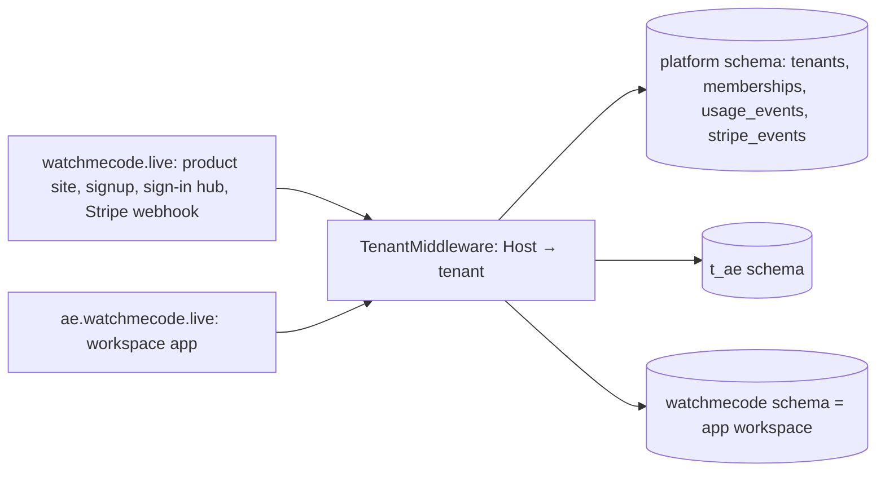

# Deployment

## Vercel

| Setting | Value |
| --- | --- |
| Project | `levensailors-projects/watchmecode-live` |
| Framework preset | FastAPI, entrypoint `api.index:app` (set in `pyproject.toml`) |
| Region | `iad1` |
| Production | `main` branch → [watchmecode.live](https://watchmecode.live) |
| Previews | Every other branch gets its own URL |

Pushing to GitHub deploys automatically. For a non-interactive CLI deploy, use `VERCEL_TOKEN`, `VERCEL_ORG_ID`, and `VERCEL_PROJECT_ID`.

### Environment variables

| Name | Production | Preview |
| --- | --- | --- |
| `GOOGLE_CLIENT_ID`, `GOOGLE_CLIENT_SECRET`, `GOOGLE_SCOPES`, `SESSION_SECRET` | yes | yes |
| `GOOGLE_REDIRECT_URI` = `https://watchmecode.live/auth/google/callback` | yes | derived from the request URL |
| `PUBLIC_URL` | yes | no |
| `POSTGRES_URL` and the other Supabase keys | injected by the integration | injected |

Add one with:

```bash
printf '%s' "$VALUE" | vercel env add NAME production
vercel env add NAME preview "" --value "$VALUE" --yes
```

### Google OAuth client

Authorize these redirect URIs on the Google client:

- `https://watchmecode.live/auth/google/callback`
- `http://127.0.0.1:8000/auth/google/callback`

Preview URLs change on every deploy, so Google sign-in works on production and locally. Candidates can join previews with a PIN.

### Database

The Supabase resource `supabase-orange-park` from the Vercel Marketplace is connected to the project. The app creates the `watchmecode` schema and its tables on startup, with row-level security enabled. To create them by hand, run [`sql/schema_postgres.sql`](https://github.com/levensailor/watchmecode.live/blob/main/sql/schema_postgres.sql) after `CREATE SCHEMA watchmecode; SET search_path TO watchmecode;`.

### Runtimes on Vercel

| Language | On Vercel |
| --- | --- |
| Python | Runs; imports auto-install with `pip install --target /tmp/...` |
| Shell | Runs |
| HTML/CSS/JS | Renders in the browser preview |
| JavaScript, TypeScript, Java, C#, C++, C, Go, PHP | Clear "not installed on this server" message |

Self-host on a machine with the toolchains on `PATH` to run all ten. With uv installed, Python uses `uv run --with`. JavaScript uses `npm install`, plus `nvm use` when nvm is present.

## Workspaces

With `ROOT_DOMAIN` set, one deployment serves the product site at the apex and every shared workspace at `<slug>.ROOT_DOMAIN`.



| Step | Command or setting |
| --- | --- |
| Wildcard domain | `vercel domains add '*.watchmecode.live'` |
| Turn it on | `ROOT_DOMAIN=watchmecode.live`, `PUBLIC_URL=https://watchmecode.live` |
| Signing key | `HANDOFF_PRIVATE_KEY` (base64 32-byte seed). Without it the key is derived from `SESSION_SECRET` |
| Google | Keep only the apex callback `https://watchmecode.live/auth/google/callback`; workspaces sign in through the hub |
| Schema | Created on startup from `sql/platform_postgres.sql`; `uv run python scripts/migrate.py` migrates every workspace up front |

Requests on the apex that carry a workspace-scoped API key (`wmc_<slug>.…`) are routed to that workspace, so integrations can keep calling `https://watchmecode.live/v1/…`. Unknown subdomains get a 404 page with a link to claim the name.

### Billing

1. Put `STRIPE_SECRET_KEY` (test mode first) in `.env`.
2. `uv run python scripts/stripe_setup.py` shows the plan; `--apply` creates the Starter and Team products, monthly and annual prices, graduated overage prices tied to the `interview_credits` meter, and a webhook endpoint at `/api/stripe/webhook`. It writes `STRIPE_PRICES` and `STRIPE_WEBHOOK_SECRET` to `.env`.
3. Copy the three `STRIPE_*` values to Vercel production.

Trials stop at 15 credits. Paid plans keep working past their allowance, and every credit is reported to the meter so Stripe bills only usage beyond the free tier.

### Sandbox runner

Set `SANDBOX_BACKEND=sandbox` to run code in Vercel Sandbox microVMs (`vercel` Python SDK). On Vercel the SDK authenticates with the deployment's OIDC token automatically. Locally, `vercel env pull` provides `VERCEL_OIDC_TOKEN`. If the sandbox is unreachable, runs fall back to the local runner with a note in the console.

### Dedicated instances

See the [dedicated instance runbook](runbooks/dedicated.md).

## Read the Docs

`.readthedocs.yaml` builds this MkDocs site. To publish, import `levensailor/watchmecode.live` at [readthedocs.org/dashboard/import](https://readthedocs.org/dashboard/import/). Builds then run on every push.

## CI

`.github/workflows/ci.yml` installs uv and Node, then runs `uv sync` and `uv run pytest` on every push and pull request.
