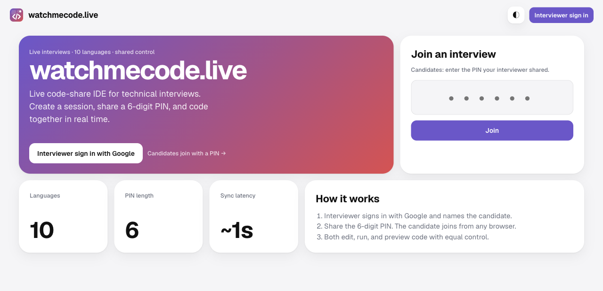
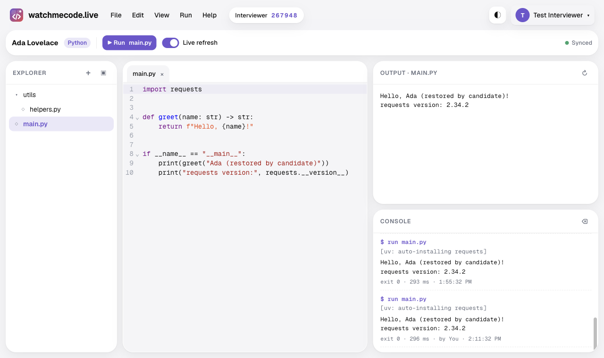

# watchmecode.live

**Share a 6-digit PIN, open one editor, and run real code together.**

watchmecode.live is a live code-share IDE for technical interviews, in the spirit of CoderPad, HackerRank, and CodePen. An interviewer creates a session for a named candidate and gets a PIN. The candidate types the PIN, and both people edit, run, and preview code with equal control.

| Link | Where |
| --- | --- |
| App | [watchmecode.live](https://watchmecode.live) |
| Interactive API docs | [watchmecode.live/docs](https://watchmecode.live/docs) |
| Source | [github.com/levensailor/watchmecode.live](https://github.com/levensailor/watchmecode.live) |

## At a glance

| Feature | Details |
| --- | --- |
| PIN sessions | Unique 6-digit PIN per active session; ending a session retires it |
| Equal control | Explorer, tabs, editor, console, preview, and Run are shared; edits sync in about a second |
| Languages | Python, JavaScript, TypeScript, Java, C#, C++, C, Go, PHP, Shell, plus an HTML/CSS/JS playground |
| Auto-install | Python and JavaScript imports install on Run |
| Live refresh | Re-runs code after edits |
| Candidate portal | Sessions grouped by candidate, reopenable after the interview |
