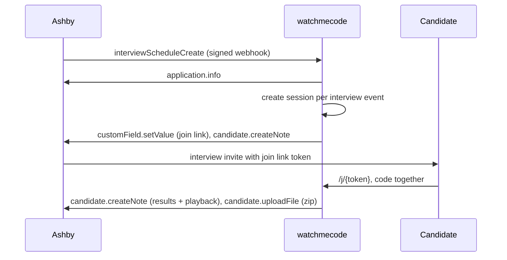

# Ashby

watchmecode connects to Ashby in two ways. Both are configured per organization under **Organization settings**.

| Feature | How it works | Ashby partnership needed? |
| --- | --- | --- |
| **Live interviews** | Ashby webhooks create one watchmecode session per scheduled interview. The candidate join link is written to Ashby, and results come back when the interview ends. | No |
| **Take-home assessments** | Recruiters add a watchmecode assessment to an interview plan. Ashby calls watchmecode's Assessments Partner API to start it, and watchmecode reports status and results back. | Yes, to appear in Ashby's integration list ([application draft](ashby-partner-application.md)) |

## Before you start

- You need an Ashby **Organization Admin** to create the API key and webhooks.
- In watchmecode, create an organization (**Organization settings → New organization**) and add your interviewers as members. Interviewers on Ashby interview events are added automatically.

## 1. Create an Ashby API key

Ashby → **Admin → Integrations → API Keys → New**. Grant:

| Module | Access | Used for |
| --- | --- | --- |
| Candidates | Read and write | `application.info`, `candidate.createNote`, `candidate.uploadFile`, `customField.setValue`, `assessment.update`, `assessment.addCompletedToCandidate` |
| Interviews | Read | Interview schedule data in webhooks |
| Organization | Read | `user.search`, which attributes notes to the interviewer |

Optionally enable **Allow acting on behalf of a user**, so result notes show the interviewer as the author instead of the API key.

## 2. Connect Ashby in watchmecode

**Organization settings → Ashby**:

| Field | What to enter |
| --- | --- |
| API key | The key from step 1 (stored encrypted) |
| Join link field | ID of a **Candidate** custom field (see step 4). Optional, but needed for the link to appear in invites. |
| Interview stages | Ashby interview stage IDs to watch. Leave blank for all stages. |
| Default language | Starter files for new sessions |
| Toggles | Post the join link as a note · post results and playback · upload the final code (zip) · record live interviews as completed assessments |

Press **Connect**, then **Test**.

## 3. Add the webhooks

Ashby → **Admin → Integrations → Webhooks → New**. Create one webhook per event type:

- `interviewScheduleCreate`
- `interviewScheduleUpdate`

Use the **Webhook URL** shown in watchmecode (`https://watchmecode.live/integrations/ashby/webhook/<your-org-slug>`). For **Secret Token**, press **Reveal secret** in watchmecode and copy it in. watchmecode rejects any request without a valid `Ashby-Signature`.

What happens:

| Schedule event | watchmecode action |
| --- | --- |
| Interview scheduled | A live session is created per interview event. The candidate link goes to the custom field and a note. |
| Interview removed from a schedule | Its session ends |
| Schedule cancelled | All of its sessions end, and no results are posted |
| Interview not yet scheduled (`NeedsScheduling` and similar) | Ignored until it's scheduled |

## 4. Put the join link in candidate invites

Ashby email templates and calendar invites can include **candidate** custom fields as tokens (Plus and Enterprise plans):

1. Ashby → **Admin → Custom Fields → Candidate → New**: Title `watchmecode link`, type **Short answer**.
2. Edit the field and check **Enable in Email Templates**. Copy its ID (or set a Reference ID) into **Join link field** in watchmecode.
3. Add the token to your interview confirmation template or calendar invite.

Each new interview session overwrites the field with the latest join link. The link opens the IDE directly; no PIN is needed.

## 5. Results back in Ashby

When an interviewer ends the session, or presses **Stop recording**:

- **Note**: language, duration, runs, last output, and links to the session and playback. It's attributed to the interviewer when `X-On-Behalf-Of` is allowed.
- **File**: `watchmecode-<candidate>-<id>.zip` with the final code
- **Completed assessment** (optional): result plus metadata for runs, duration, and the playback link

Results are pushed once per session. Failures show as **Last error** on the Ashby card and never block interviewers.

## Take-home assessments (Assessments Partner API)

1. In watchmecode, add assessments under **Organization settings → Take-home assessments** (name, language, time limit, starter code).
2. Create a watchmecode **API key** (Organization settings → API keys).
3. Once watchmecode is listed in Ashby: Ashby → Integrations → watchmecode → paste the watchmecode API key. Ashby calls `https://watchmecode.live/partners/ashby/*` with Basic Auth.
4. Add a watchmecode activity to an interview plan stage and pick an assessment. **Start Assessment** emails the candidate a link (when email is configured) and returns the link to Ashby as metadata.

The candidate gets a solo IDE with a countdown and a **Submit** button. watchmecode reports `Started` when the candidate opens it. On submit or timeout, it sends `assessment_result`, a profile link, metadata (time spent, runs, files, download, playback), and uploads the code. Cancelling in Ashby ends the session.

## Troubleshooting

| Symptom | Check |
| --- | --- |
| Webhook returns 401 | The secret in Ashby must match **Reveal secret**. Rotating it in watchmecode requires updating Ashby. |
| Webhook returns 404 | The org slug in the URL, and that Ashby is still connected |
| No sessions created | Interview stage filter, and whether the schedule status is `Scheduled` |
| Link not in invites | Field type must be **Short answer** on a **Candidate** field with Enable in Email Templates. Check your Ashby plan. |
| Last error mentions permissions | The API key needs Candidates write access |
