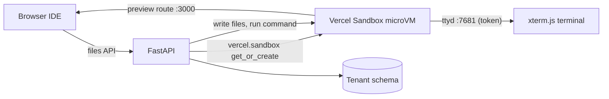

# Hands-on labs roadmap

Every major vendor (CoderPad, HackerRank, CodeSignal, Codility, Qualified, DevSkiller) now ships multi-file "real work" labs. These include a terminal, package installs, hidden tests, and a live preview, each running in an isolated container or VM per candidate.

## Lab types

| Lab | Value to hiring teams | Competitor examples | Runtime | Effort | Status |
| --- | --- | --- | --- | --- | --- |
| SQL | Analyst, data, and backend roles | HackerRank SQL, CodeSignal DB tasks | Server SQLite seeded from CSV files (works on Vercel); PGlite or DuckDB-WASM later | S | **Shipped** |
| Frontend framework (React) | Frontend roles without build tooling | CoderPad Projects, HackerRank front-end | Browser: React through esm.sh import maps in the sandboxed preview; Sandpack later for Vue or Next | S | **Shipped** |
| System design whiteboard | Senior and architecture interviews | CoderPad drawing mode, HackerRank whiteboard | Browser: Excalidraw (MIT), saved as a session file | S | **Shipped** |
| Prompt engineering (vibe coding) | AI-era hiring: can the candidate brief an agent well? | CoderPad AI, HackerRank AI interviewer | Vercel AI Gateway: an AI reviewer mocks the agent and scores intent, guardrails, and context/MCP | S | **Shipped** |
| Multi-language runner | Java, Go, C#, C++, and more on the hosted product | All vendors | Vercel Sandbox microVM | M | **Shipped** (behind `SANDBOX_BACKEND=sandbox`) |
| Project/repo lab | Realistic multi-file work, package installs, tests | CoderPad Projects, CodeSignal Filesystem, Codility | Vercel Sandbox with file sync, a terminal (ttyd on an exposed port), hidden tests | M | Next |
| Backend/API lab | Debugging and building endpoints | HackerRank Projects, DevSkiller RealLifeTesting | Vercel Sandbox with a server on an exposed port and an HTTP client panel | M | Next |
| Debugging and code review | Senior signal: read existing code | Byteboard, Codility code review | Repo template with failing tests or a PR-diff review UI | M | Next |
| Data notebook | Data science | HackerRank DS, CodeSignal | Pyodide/JupyterLite in the browser | M | Later |
| Linux/SRE broken system | SRE and DevOps roles | Instruqt, KodeKloud, SadServers, iximiuz | Vercel Sandbox if root access allows, else Fly Machines or EC2 | L | Enterprise add-on |
| Docker/Kubernetes | Platform roles | KodeKloud, Killercoda | Dedicated VM per session (EC2 or Firecracker pool) | L | Enterprise add-on |
| Cloud account | Cloud engineering | Instruqt cloud accounts, A Cloud Guru | AWS Innovation Sandbox account leases | L | Enterprise add-on |
| AI-assisted coding | AI-era signal | CoderPad AI, HackerRank AI interviewer | In-IDE assistant per interview (allow or block), with prompts logged | M | Next |

## Runtime options

| Option | Isolation | Cold start | Price signal | Fit |
| --- | --- | --- | --- | --- |
| In the browser (esm.sh, Excalidraw, Pyodide, PGlite) | Browser sandbox | Instant | Free | Best for SQL, frontend, whiteboard |
| **Vercel Sandbox** | Firecracker microVM | Seconds; snapshots resume | About $0.11 per light 1-hour session; CPU billed only when active | **Primary.** Python SDK (`vercel.sandbox`), exposed ports, snapshots, network policy, OIDC auth on Vercel. |
| E2B | Firecracker | About 150 ms | About $0.17 per hour | Backup |
| Daytona, Modal | Container or gVisor | Fast | Usage-based | Alternatives |
| Fly Machines, EC2 | Full VM | Seconds to minutes | Per VM | Docker/Kubernetes and root labs |
| Judge0 | Container | Fast | Self-hosted | Single-file judging only |

## Architecture (Vercel + Supabase)

1. **One sandbox per session:** named `wmc-<tenant>-<session>`, created on the first run with `get_or_create_sandbox`. Its execution limit matches the interview length.
2. **Files:** the session's `files` table stays the source of truth. Each run writes the files into `/workspace` before it executes.
3. **Commands:** run with `run_process` and the output limits the local runner already uses. Installs reuse the sandbox, so dependencies stay cached for the session.
4. **Preview:** an exposed port route (`box.routes`) is shown in the Preview pane for backend and frontend servers.
5. **Terminal (next):** ttyd on a second port with a per-session token, connected to xterm.js.
6. **Tests and grading (next):** hidden test files are written at grading time only, and pass/fail is reported in results and to the ATS.
7. **Lifecycle:** the sandbox stops when the session ends; snapshots keep state for take-homes.
8. **Cost controls:** an execution-time limit, idle stop, a network allowlist (package registries only), and lab runs cost 2 credits.
