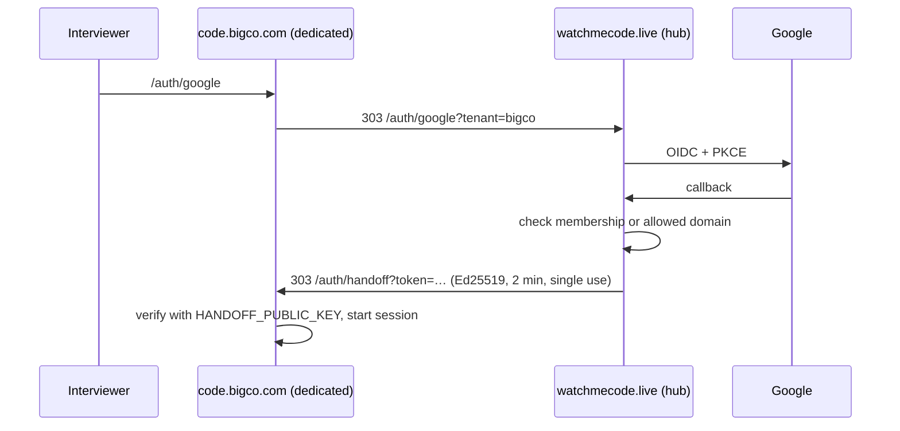

# Runbook: dedicated Enterprise instance

An Enterprise customer gets their own Vercel project, their own Postgres database, and their own domain. The instance runs this repository with `TENANT_MODE=dedicated`. Interviewers still sign in at the apex auth hub, which signs a short-lived Ed25519 handoff token. The instance verifies it with only the hub's **public** key, so no shared secret leaves the hub.



## Before you start

| You need | Where it comes from |
| --- | --- |
| `VERCEL_TOKEN`, `VERCEL_TEAM_ID` | Vercel → Account settings → Tokens; the team id from `vercel teams ls` |
| `SUPABASE_ACCESS_TOKEN`, `SUPABASE_ORG_ID` | Supabase → Account → Access tokens; the org id from the dashboard URL |
| or `NEON_API_KEY` | Neon → Account → API keys |
| Hub settings | Production `ROOT_DOMAIN`, `PUBLIC_URL`, and `DATABASE_URL` (pull them with `vercel env pull .env.production`) so the script can register the tenant with the hub |

The hub's signing key comes from `HANDOFF_PRIVATE_KEY`, or it is derived from the hub's `SESSION_SECRET`. Set `HANDOFF_PRIVATE_KEY` explicitly before you provision the first dedicated instance, so that rotating `SESSION_SECRET` doesn't break dedicated sign-in.

## Provision

1. Dry run, and read the plan:

   ```bash
   uv run python scripts/provision_dedicated.py --slug bigco --name "BigCo" --owner admin@bigco.com \
     --domain code.bigco.com --allowed-domain bigco.com
   ```

2. Apply:

   ```bash
   set -a; source .env.production; set +a
   uv run python scripts/provision_dedicated.py --slug bigco --name "BigCo" --owner admin@bigco.com \
     --domain code.bigco.com --allowed-domain bigco.com --db supabase --region iad1 --apply
   ```

   The script:
   - creates the database (Supabase waits until it's healthy);
   - creates the Vercel project from this repo;
   - sets `TENANT_MODE`, `TENANT_SLUG`, `PUBLIC_URL`, `AUTH_HUB_URL`, `HANDOFF_PUBLIC_KEY`, `DATABASE_URL`, and freshly generated `SESSION_SECRET`, `INTEGRATION_ENCRYPTION_KEY`, and `CRON_SECRET`;
   - pins the function region, attaches the domain, and starts a production deployment;
   - registers the workspace with the hub as `deployment=dedicated`.

   Secrets are written to `.dedicated/<slug>.env` (gitignored, mode 600). Store that file in the team password manager, then delete it.

3. **DNS:** if the domain isn't on Vercel DNS, ask the customer for a `CNAME` to `cname.vercel-dns.com` (or the A record Vercel shows). Subdomains of `ROOT_DOMAIN` on Vercel DNS verify automatically, and an explicit domain on the dedicated project takes priority over the shared project's wildcard.

4. **Smoke test:**
   - `curl https://code.bigco.com/api/health` returns `{"status":"ok","storage":"postgres",…}`;
   - sign in through `https://watchmecode.live/api/platform/go/bigco`;
   - create a session, join it from a private window, and run code.

## Operate

| Task | How |
| --- | --- |
| Add people | Add their Google domain with `--allowed-domain` (re-run with `--apply` is idempotent for the hub row), or insert into `platform.memberships` |
| Deploy a new version | Pushing to `main` redeploys the shared project and every dedicated project linked to the repo |
| Schema changes | Automatic on cold start (`CREATE … IF NOT EXISTS`); run `uv run python scripts/migrate.py` with the instance's env to do it up front |
| Rotate instance secrets | Update the Vercel env and redeploy. Rotating `INTEGRATION_ENCRYPTION_KEY` requires re-entering ATS credentials |
| Offboard | Set the hub row's `status` to `canceled`, export with the pads API, then delete the Vercel project and the database |

The shared deployment refuses to serve a `deployment=dedicated` workspace (404), even if traffic for its subdomain reaches it, and the shared cron skips it.
